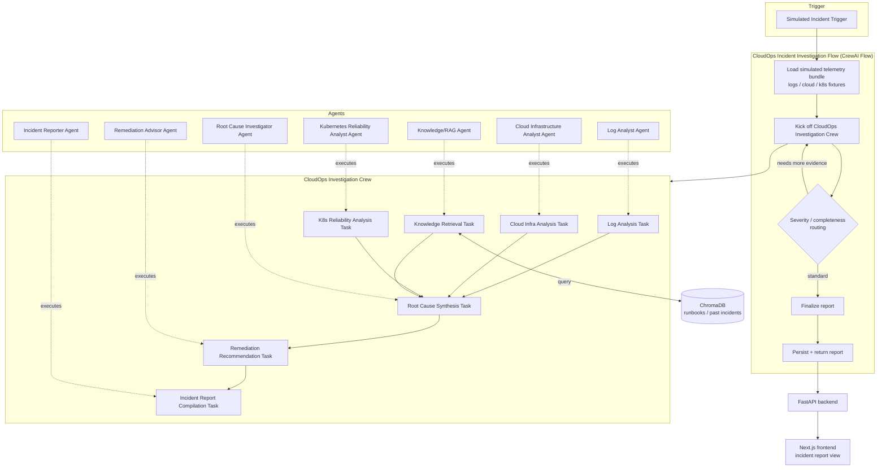

# Architecture — Cloud Ops AI Intelligence

## 1. Architectural principle

The system is built strictly as a layered CrewAI application:

```
CrewAI
  ├── Agents   — WHO investigates (role, goal, expertise)
  ├── Tasks    — WHAT each agent does (one responsibility, one expected output)
  ├── Crew     — HOW agents+tasks are assembled into a coordinated investigation
  └── Flow     — WHEN/WHY the crew runs (application-level trigger, branching, persistence)
```

Each layer only depends on the layer below it:

- **Agents** are defined independently of any specific incident — role, goal, backstory,
  and the tools they're permitted to use.
- **Tasks** bind an agent to a concrete unit of work (description, expected output,
  context from other tasks) but still know nothing about *when* they run.
- **Crew** assembles a fixed roster of agents and tasks into "CloudOps Investigation Crew"
  and defines the process (sequential/hierarchical) and inter-task context passing.
- **Flow** is the only layer aware of the outside world: it receives an incident trigger,
  prepares/loads the simulated data context, kicks off the Crew, applies any
  application-level branching (e.g., severity-based routing), and hands the final report to
  the FastAPI layer for persistence/serving.

No layer may be skipped or bypassed once implementation starts (see CLAUDE.md).

## 2. High-level system diagram



## 3. Component overview

| Component | Responsibility | Notes |
|---|---|---|
| Simulated data layer | Provides fixture logs, cloud state, and K8s state per incident scenario | No live cloud/K8s connection in V1 |
| Agents | Role-scoped reasoning over one evidence domain each | Defined in `agent-design.md` |
| Tasks | Bind agents to concrete, ordered units of work with explicit expected output | One task = one responsibility |
| Crew (CloudOps Investigation Crew) | Assembles the 7 agents/tasks, manages context passing between tasks | Process type documented in `agent-design.md` |
| Flow (CloudOps Incident Investigation Flow) | Application-level orchestration: trigger → data prep → crew kickoff → routing → persistence | The only layer that talks to FastAPI |
| ChromaDB knowledge store | Vector store of simulated runbooks, architecture docs, past incident write-ups | Queried only by the Knowledge/RAG Agent |
| FastAPI backend | Exposes an endpoint to trigger an investigation and fetch a report | Read-only w.r.t. infrastructure; no remediation endpoints |
| Next.js frontend | Displays incident reports and investigation status to a human operator | Consumes FastAPI only |

## 4. Data flow

1. A simulated incident trigger (JSON payload: incident id, alert description, affected
   service/namespace, time window) initiates the Flow.
2. The Flow loads the matching simulated telemetry bundle (log fixtures, cloud-state
   fixtures, K8s-state fixtures) for that incident scenario.
3. The Flow kicks off the CloudOps Investigation Crew with this context.
4. The Log Analyst, Cloud Infrastructure Analyst, and Kubernetes Reliability Analyst agents
   independently analyze their respective evidence domains. The Knowledge/RAG Agent queries
   ChromaDB for related historical incidents/runbooks.
5. The Root Cause Investigator Agent consumes all four outputs and produces ranked root
   cause hypotheses with supporting evidence.
6. The Remediation Advisor Agent consumes the root cause output and produces ranked,
   non-executed remediation recommendations.
7. The Incident Reporter Agent compiles everything into a final structured report.
8. The Flow applies any application-level routing (e.g., if evidence is insufficient,
   loop back for a deeper pass — see §5), then persists and returns the report via FastAPI.
9. The Next.js frontend renders the report for a human operator.

## 5. Flow responsibilities (application-level orchestration)

The Flow layer owns everything the Crew itself should not know about:

- Accepting/validating the incident trigger.
- Loading the correct simulated data bundle for the scenario.
- Deciding whether one Crew pass is sufficient or whether to re-invoke with refined
  instructions (e.g., low-confidence root cause).
- Persisting the final report (V1: in-process/local storage; no production data store).
- Handing the report to the FastAPI layer for the frontend to consume.
- Owning all logging/observability of the investigation lifecycle.

The Crew itself remains reusable and untangled from any specific trigger source, so it can
later be invoked from a CLI, a test harness, or a different API without modification.

## 6. Process type (Crew)

CloudOps Investigation Crew uses a **sequential process with parallelizable evidence
gathering**: the four evidence-gathering tasks (log, cloud, K8s, knowledge retrieval) have
no dependency on each other and may execute concurrently; the root cause synthesis task
explicitly depends on all four; remediation and reporting are strictly sequential after
that. Exact CrewAI process/async configuration is decided at implementation time and
documented in `agent-design.md`, not changed here without updating this document.

## 7. Tech stack mapping

| Concern | Technology |
|---|---|
| Agent/Task/Crew/Flow runtime | CrewAI (Python 3.11) |
| LLM calls | OpenAI API |
| Vector knowledge store | ChromaDB |
| Backend API | FastAPI |
| Frontend | Next.js + TypeScript |
| Testing | pytest |
| Source control | Git |

## 8. Proposed repository layout (for future implementation — not created yet)

```
cloud-ops-ai-intelligence/
├── backend/
│   ├── app/
│   │   ├── agents/         # CrewAI Agent definitions
│   │   ├── tasks/          # CrewAI Task definitions
│   │   ├── crew.py         # CloudOps Investigation Crew assembly
│   │   ├── flow.py         # CloudOps Incident Investigation Flow
│   │   ├── api/             # FastAPI routes
│   │   ├── knowledge/       # ChromaDB client + ingestion of simulated runbooks
│   │   └── simulated_data/  # Fixture logs / cloud state / K8s state per scenario
│   └── tests/                # pytest suite
├── frontend/
│   └── (Next.js + TypeScript app)
└── docs/
```

This layout is descriptive of intended structure only; it must not be scaffolded until
implementation is explicitly requested (see CLAUDE.md).
